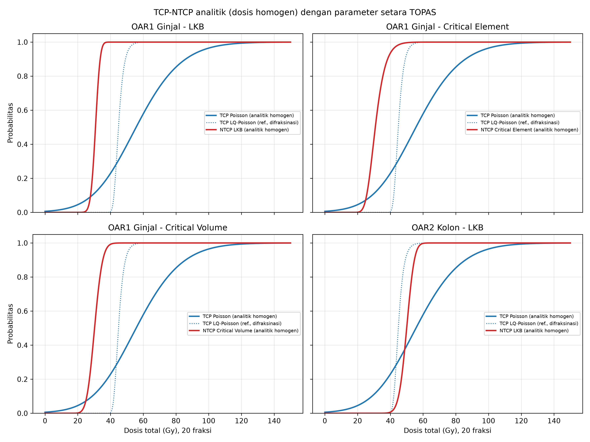

# Perbandingan TCP–NTCP: Model Analitik vs Simulasi TOPAS

Repositori ini berisi pemodelan analitik *Tumor Control Probability* (TCP) dan
*Normal Tissue Complication Probability* (NTCP) yang parameternya **disamakan
dengan simulasi Monte Carlo TOPAS**. Tujuannya agar perbandingan antara model
analitik (Python) dan simulasi TOPAS dapat dilakukan secara sah: satu-satunya
perbedaan yang tersisa adalah **distribusi dosis**.

| | Model analitik (repositori ini) | Simulasi TOPAS |
|---|---|---|
| Distribusi dosis | Homogen (seluruh volume organ menerima dosis sama) | DVH hasil Monte Carlo (heterogen) |
| Rumus TCP/NTCP | Replika kode TOPAS | Kode TOPAS |
| Parameter radiobiologi | Sama | Sama |
| Fraksinasi | Sama (20 fraksi, koreksi EQD) | Sama |

Dengan demikian, selisih kurva analitik dan TOPAS dapat ditafsirkan sebagai
efek heterogenitas dosis dan geometri organ berisiko.

## Struktur folder

```
.
├── kode_TOPAS/   Kode sumber model outcome TOPAS (acuan rumus)
│   ├── TsPoissonModel.cc/.hh          TCP Poisson (Warkentin et al., 2004)
│   ├── TsLKBModel.cc/.hh              NTCP Lyman-Kutcher-Burman (gEUD + probit)
│   ├── TsCriticalElementModel.cc/.hh  NTCP Critical Element (Niemierko & Goitein, 1991)
│   ├── TsCriticalVolumeModel.cc/.hh   NTCP Critical Volume (Stavrev et al., 2001)
│   └── TsOutcomeModelList.cc/.hh      Pemanggil model + koreksi fraksinasi
├── python/
│   └── TCP_NTCP_Analitik_Setara_TOPAS.py
└── hasil/
    ├── TCP_NTCP_Analitik_Setara_TOPAS.png   Grafik kurva TCP–NTCP
    └── TCP_NTCP_Analitik_Setara_TOPAS.csv   Data kurva
```

## Model dan parameter

**Koreksi fraksinasi** (seperti `TsVOutcomeModel::CalculateBED`):

$$EQD_{d_{ref}} = D \cdot \frac{\alpha/\beta + D/N}{\alpha/\beta + d_{ref}}$$

**TCP Poisson** (target):

$$TCP = 0{,}5^{\exp\left(\frac{2\gamma_{50}}{\ln 2}\left(1 - \frac{D}{TCD_{50}}\right)\right)}$$

**NTCP LKB**:

$$NTCP = \Phi\left(\frac{gEUD - TD_{50}}{m \cdot TD_{50}}\right)$$

| Parameter | Nilai | Keterangan |
|---|---|---|
| Jumlah fraksi | 20 | `Sc/*/NumberOfFractions` |
| Dosis per fraksi referensi | 2,0 Gy | `DosePerFraction` (default TOPAS) |
| α/β target | 3 Gy | Default TOPAS bila tidak di-set |
| α/β OAR | 3 Gy | `Sc/OAR*/AlphaOverBeta` |
| TCD₅₀ / γ₅₀ (target) | 64,38 Gy / 0,69 | Okunieff et al. (1995) |
| LKB ginjal (n, m, TD₅₀) | 0,70 / 0,10 / 28 Gy | Burman et al. (1991) |
| Critical Element ginjal (γ, TD₅₀) | 2,0 / 28 Gy | |
| Critical Volume ginjal (μcr, σ, D50, γ50) | 0,22 / 0,05 / 59 Gy / 0,4 | Stavrev et al. (2001) |
| LKB kolon (n, m, TD₅₀) | 0,17 / 0,11 / 55 Gy | Burman et al. (1991) |
| Kriteria therapeutic window | TCP ≥ 50 % dan NTCP ≤ 5 % | Dihitung otomatis |

Semua parameter dapat diubah di bagian **1. PARAMETER** pada awal skrip.

## Cara menjalankan

Kebutuhan: Python 3.9 atau lebih baru.

```bash
pip install -r requirements.txt
```

```bash
cd python
python TCP_NTCP_Analitik_Setara_TOPAS.py
```

Skrip mencetak tabel ringkasan (TCP50, NTCP5, NTCP50, dan rentang therapeutic
window), lalu menyimpan grafik `.png` dan data `.csv` di folder tempat skrip
dijalankan.

### Menampilkan hasil TOPAS pada grafik yang sama (opsional)

Buat folder `topas_csv/` di folder tempat skrip dijalankan, lalu isi dengan
file CSV hasil TOPAS. Kolom pertama adalah dosis total (Gy), kolom berikutnya
TCP/NTCP (0–1 atau %), contoh:

```
Dose,TCP,NTCP_LKB,NTCP_CE,NTCP_CV
20,0.04,0.00,0.01,0.00
...
```

## Hasil ringkas

Dengan parameter di atas (dosis homogen, 20 fraksi):

| | Dosis 50 % | Therapeutic window |
|---|---|---|
| TCP target | 55,7 Gy | – |
| NTCP ginjal – LKB | 30,9 Gy | tidak ada |
| NTCP ginjal – Critical Element | 30,9 Gy | tidak ada |
| NTCP ginjal – Critical Volume | 30,3 Gy | tidak ada |
| NTCP kolon – LKB | 50,0 Gy | tidak ada |

Model homogen setara dengan kondisi terburuk (seluruh organ berisiko menerima
dosis target), sehingga hasilnya konsisten dengan simulasi TOPAS *on-axis*.
Munculnya therapeutic window pada konfigurasi *off-axis* di TOPAS dengan
demikian berasal dari efek geometri dan heterogenitas dosis.



## Catatan

- Nilai preset LKB ginjal dan kolon diambil dari Burman et al. (1991). Cocokkan
  dengan `Sc/LKBValues/Kidney` dan `Sc/LKBValues/colon` di file
  `LKMModelBurman.txt` yang dipakai saat simulasi.
- Kode di `kode_TOPAS/` membutuhkan kelas dasar `TsVOutcomeModel.cc/.hh` dari
  distribusi TOPAS untuk dapat dikompilasi.
- `TsCriticalVolumeModel::Initialize` mengubah nilai `fSigma` setiap kali
  dipanggil. Bila beberapa titik dosis dihitung dalam satu sesi TOPAS, nilai
  sigma ikut berubah; jalankan setiap titik dosis sebagai sesi terpisah.

## Lisensi

Kode di folder `kode_TOPAS/` adalah milik **The TOPAS Collaboration** dan
didistribusikan di bawah lisensi MIT sebagaimana tercantum di header setiap
file. Header lisensi tersebut tidak boleh dihapus.

## Referensi

- Burman, C., Kutcher, G. J., Emami, B., & Goitein, M. (1991). Fitting of normal tissue tolerance data to an analytic function. *Int. J. Radiat. Oncol. Biol. Phys.*, 21(1), 123–135.
- Niemierko, A., & Goitein, M. (1991). Calculation of normal tissue complication probability and dose-volume histogram reduction schemes for tissues with a critical element architecture. *Radiother. Oncol.*, 20, 166–176.
- Okunieff, P., Morgan, D., Niemierko, A., & Suit, H. D. (1995). Tumor dose-response based on data from human and animal studies. *Int. J. Radiat. Oncol. Biol. Phys.*, 32(5), 1227–1237.
- Perl, J., Shin, J., Schümann, J., Faddegon, B., & Paganetti, H. (2012). TOPAS: An innovative proton Monte Carlo platform for research and clinical applications. *Med. Phys.*, 39(11), 6818–6837.
- Stavrev, P., Stavreva, N., Niemierko, A., & Goitein, M. (2001). Generalization of a model of tissue response to radiation based on the idea of functional subunits and binomial statistics. *Phys. Med. Biol.*, 46, 1501–1518.
- Warkentin, B., Stavrev, P., Stavreva, N., Field, C., & Fallone, B. G. (2004). A TCP-NTCP estimation module using DVHs and known radiobiological models and parameter sets. *J. Appl. Clin. Med. Phys.*, 5(1), 50–63.
